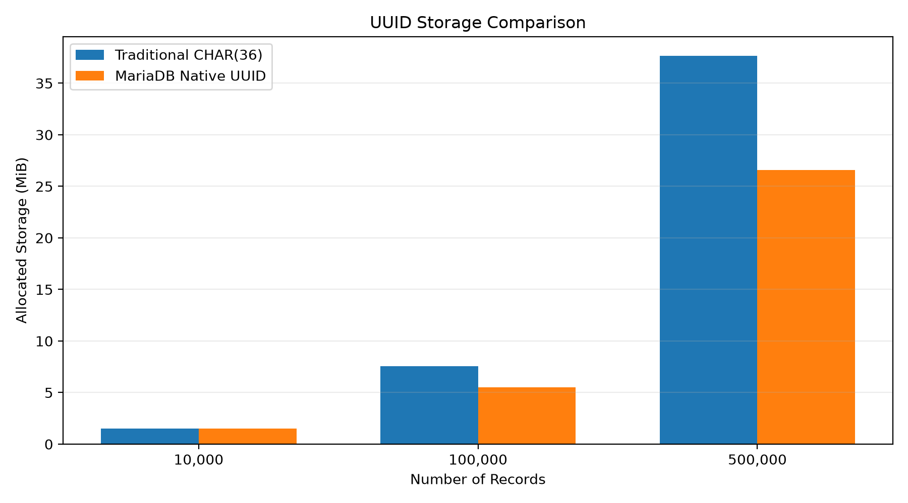
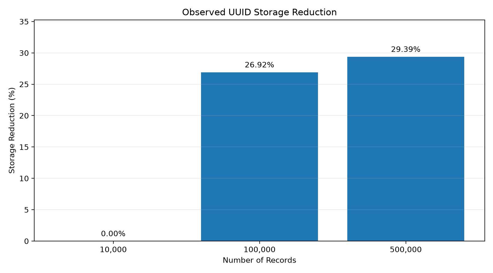
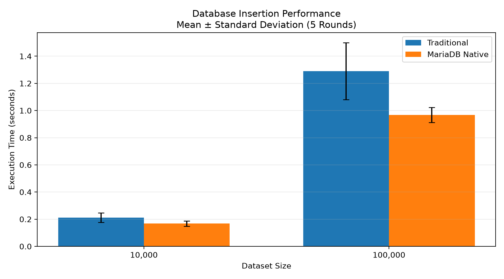
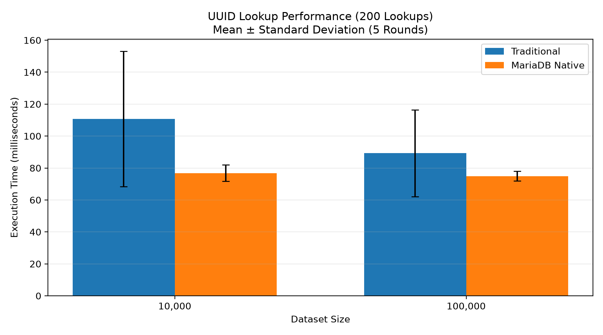
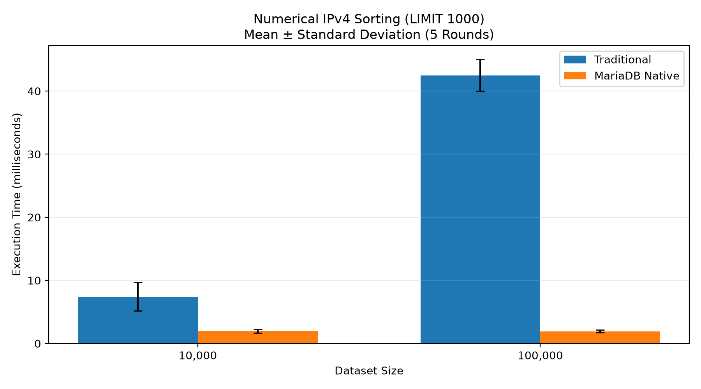

A project for area 1, "SQL that saves you work" for the MariaDB student database projects, 2026-09.
MariaDB Network Device Registry
Introduction to Database Systems — Constructor University
MariaDB Student Project 2026, Tier A: SQL That Saves You Work
About our project
For this project, we wanted to try out some MariaDB features that we had not used before and see whether they actually make a difference. We decided to use a network device registry as our example. It is a fairly simple database idea: a university or company needs to keep track of its routers, computers, printers, and other devices. Each device has a name, an IP address, a type, and a location.

The part we were interested in was how to store and work with that information. We made two versions of the registry. One uses regular text columns for IDs and IP addresses. The other uses MariaDB's UUID and INET4 types. Having both versions let us try the same operations and compare what happened.

We also explored INSERT ... RETURNING, INTERSECT, and EXCEPT. They are useful for different reasons: one can save an extra query when adding a record, and the others make it easier to compare lists of records.

This repository includes our SQL scripts, the Python code we used for benchmarking, five automated tests, and the measurements and graphs from our experiments. It is mainly a database project and tutorial, not a finished app with a website or user interface.

Team: Kevin Kotarja, Eda Zekjiri, Rasul Sharifov, and Elena Lazic.

The original project topic is described on the MariaDB Student Database Projects page.

Start here: Set up the database · Run the SQL experiments · See the results · [Read the setup checks](docs/setup_verification.md)
What we tried to find out
Our main question was whether using MariaDB's built-in SQL features could make our registry simpler, more reliable, or faster than using ordinary SQL data types and queries.

We looked at four groups of features:

UUID versus CHAR(36). A UUID is an identifier such as 123e4567-e89b-12d3-a456-426655440000. We wanted to know whether using the actual UUID type would save storage compared with storing that value as text.

INET4 versus VARCHAR(15). We tested whether MariaDB could reject an incorrect IPv4 address and whether IP addresses were sorted in the order we expected.

INSERT ... RETURNING. We compared inserting a device and then looking it up with a query that inserts the device and returns its details straight away.

INTERSECT and EXCEPT. We used these to find devices that appear in both registries, or only in one.

The project also includes a small performance comparison. We measured inserts, UUID lookups, and IP sorting with 10,000 and 100,000 records.
What we used
The database runs on MariaDB 11.8 through Docker Compose. During our development, the server reported version 11.8.9. Our computer used Windows with WSL2/Ubuntu and Visual Studio Code. We also used Python, PyMySQL, python-dotenv, Matplotlib, and Git.

For reference, our recorded versions were Python 3.14.4, Docker Engine 29.8.2, Docker Compose 5.5.1, and Git 2.53.0. You do not need exactly those versions to try the project, but we have not checked every possible combination.

You can check the version of your MariaDB server with:
SELECT VERSION();
How the database is set up
We used two main tables: devices_baseline and devices_native. They hold the same information, and the main difference is how the ID and IP address are stored. Both tables use InnoDB.

The baseline table uses CHAR(36) for the UUID and VARCHAR(15) for the IPv4 address:
CREATE TABLE IF NOT EXISTS devices_baseline (
    id CHAR(36) PRIMARY KEY,
    hostname VARCHAR(100) NOT NULL,
    ip_address VARCHAR(15) NOT NULL,
    device_type VARCHAR(50),
    location VARCHAR(100),
    created_at TIMESTAMP DEFAULT CURRENT_TIMESTAMP
) ENGINE=InnoDB;
The second table has the same columns but uses UUID and INET4:
CREATE TABLE IF NOT EXISTS devices_native (
    id UUID PRIMARY KEY,
    hostname VARCHAR(100) NOT NULL,
    ip_address INET4 NOT NULL,
    device_type VARCHAR(50),
    location VARCHAR(100),
    created_at TIMESTAMP DEFAULT CURRENT_TIMESTAMP
) ENGINE=InnoDB;
id is the primary key, so each row has its own ID. hostname is a name like router-01; ip_address is the device's IPv4 address; device_type and location describe the device; and created_at is filled in when the row is created.

The two tables are not connected by a foreign key. They are two alternatives that we built for comparison. Our larger experiments use separate tables, so testing hundreds of thousands of rows does not fill up the original registry.
Where the files are
Most of the work is in these folders:
- sql/ contains the table definitions and SQL experiments.
- scripts/ contains benchmark.py and plot_results.py.
- tests/ contains test_database.py.
- results/ contains our CSV measurements, graphs, and screenshots.
- docs/ contains more detailed notes about the results, checking the setup, and fixing common problems.
Here are the main SQL files, so it is easy to find the experiment you want:
sql/
  baseline_schema.sql
  native_schema.sql
  sample_data.sql
  experiment_ip_validation.sql
  experiment_ip_sorting.sql
  experiment_uuid_storage.sql
  experiment_uuid_storage_bulk.sql
  experiment_uuid_storage_100k.sql
  experiment_uuid_storage_500k.sql
  experiment_explain.sql
  experiment_returning.sql
  experiment_intersect_except.sql
There is also a .env.example file. The real .env contains a local database password and should never be uploaded to GitHub.
Running the project yourself
These commands are written for an Ubuntu-style terminal. We used WSL2 on Windows, but Docker and Python should also work on other systems. Start in the folder where you want the project to be downloaded.
1. Get the files
git clone https://github.com/Khana400/mariadb-network-device-registry.git
cd mariadb-network-device-registry
2. Set your password
Copy the example file:
cp .env.example .env
Then open .env and choose your own password. The file needs a setting like this:
MARIADB_ROOT_PASSWORD=choose_your_own_password
Don't include your actual password in screenshots, messages, or commits. .gitignore is set to exclude .env.
3. Start the database
Make sure Docker is running, then enter:
docker compose config --quiet
docker compose up -d
docker compose ps
On the first run, the MariaDB image needs to be downloaded and initialized. The container is called network-registry-db, and the database is named network_registry. The host uses port 3307, which connects to port 3306 inside the container.

If the database is still starting, give it time to initialize before going on to the SQL commands.
4. Create the two tables
Run both commands from the main project folder:
docker compose exec -T mariadb sh -c 'mariadb -u root -p"$MARIADB_ROOT_PASSWORD" network_registry' < sql/baseline_schema.sql

docker compose exec -T mariadb sh -c 'mariadb -u root -p"$MARIADB_ROOT_PASSWORD" network_registry' < sql/native_schema.sql
5. Add the sample devices
docker compose exec -T mariadb sh -c 'mariadb -u root -p"$MARIADB_ROOT_PASSWORD" network_registry' < sql/sample_data.sql
This adds router-01 (192.168.1.1, Router, Building A) and laptop-01 (10.0.0.2, Laptop, Library) to both versions of the registry. The corresponding devices have matching UUIDs.

Only run sample_data.sql once on a fresh database. It generates new UUIDs each time, so repeating it adds new records instead of checking whether the old ones are there.
6. Check the records
You can enter the MariaDB client with:
docker exec -it network-registry-db mariadb -u root -p
Enter the password from your .env file when prompted. Then run:
USE network_registry;
SHOW TABLES;
SELECT * FROM devices_baseline;
SELECT * FROM devices_native;
You should find the two main tables and the sample devices. The larger experiment tables only appear after running their scripts. Type exit; to leave the database client.
Setup check we completed
On 17 November 2026, we checked the SQL setup in a separate database called network_registry_setup_check inside our existing MariaDB container. Both schema scripts ran, the sample-data script created two rows in each table, and the IPv4 validation, IPv4 sorting, INSERT ... RETURNING, and INTERSECT/`EXCEPT` scripts worked there. We also ran the five Python tests on our main development setup; all five passed.

This is useful evidence that the scripts work with a newly created database, but it is not yet a completely fresh Git clone with a new Docker container and volume. We have not claimed to have tested that separately. The commands, results, and remaining checks are recorded in the [setup verification guide](docs/setup_verification.md).
Experiment 1: Can INET4 catch a wrong address?
We started with something simple. We tried to insert 999.999.999.999 as a device's IP address. It has four parts, but it is not a valid IPv4 address because each part must be between 0 and 255.

With VARCHAR(15), MariaDB accepted the value because it fitted in a text column. With INET4, MariaDB rejected it. Under our strict SQL settings (STRICT_TRANS_TABLES), the error was:
ERROR 1292 (22007): Incorrect inet4 value
That was the result we were hoping to check: a column made for IP addresses understands something that a plain text column does not. You could add separate validation to a text column, but with INET4 you get this check from the data type itself.

The script uses a transaction and ends with ROLLBACK, so it does not leave the test record in the registry. After the run, both main tables still had their original two records.

To repeat the experiment:
docker compose exec -T mariadb sh -c 'mariadb --force -u root -p"$MARIADB_ROOT_PASSWORD" network_registry' < sql/experiment_ip_validation.sql
This is the one experiment where an SQL error is expected. --force allows the client to continue after the invalid insert and reach the cleanup statements. We would not use that option for ordinary setup scripts.
Experiment 2: Putting IPv4 addresses in order
For the sorting test, we used these addresses: 10.0.0.2, 10.0.0.10, 10.0.0.100, and 192.168.1.1. We inserted the same values into both tables and ordered them by the IP column.
SELECT hostname, ip_address
FROM devices_baseline
ORDER BY ip_address;

SELECT hostname, ip_address
FROM devices_native
ORDER BY ip_address;
The baseline table put 10.0.0.10 before 10.0.0.2. It sorted the values as text, comparing the characters. Its order was 10.0.0.10, 10.0.0.100, 10.0.0.2, 192.168.1.1.

The INET4 table gave the numerical order we wanted: 10.0.0.2, 10.0.0.10, 10.0.0.100, 192.168.1.1.

So the difference was not about which rows were stored, but about how MariaDB understood the addresses. With text, we can get numerical ordering by converting the values with INET_ATON(ip_address). With INET4, that conversion is not needed for this sort.

Run the full test with:
docker compose exec -T mariadb sh -c 'mariadb -u root -p"$MARIADB_ROOT_PASSWORD" network_registry' < sql/experiment_ip_sorting.sql
The extra rows are rolled back at the end.
Experiment 3: Does native UUID use less space?
This experiment took a little more work because storage differences are not always obvious with just a few records. A UUID written as normal text uses 36 ASCII characters, including hyphens. MariaDB's native UUID representation is 16 bytes. That is a theoretical saving of 20 bytes per identifier, or 55.56% compared with the 36-byte text representation.

We did not want to confuse that number with the size of a whole database table. A table needs space for other columns, indexes, and internal storage too. So we made separate tables with the same generated UUIDs and hostnames, changing only whether the ID was CHAR(36) or UUID.

We measured the allocated storage reported by MariaDB for three dataset sizes:

10,000 records. Both tables reported 1,589,248 bytes (1.516 MiB). The observed reduction was 0%. That initially looks strange given the different UUID sizes, but InnoDB allocates space in pages, not one exact chunk per row.

100,000 records. The text UUID table reported 7,913,472 bytes (7.547 MiB). The native UUID table reported 5,783,552 bytes (5.516 MiB), or 26.92% less.

500,000 records. The text version reported 39,469,056 bytes (37.641 MiB) and the native version 27,869,184 bytes (26.578 MiB). That is a difference of 11,599,872 bytes, around 11.06 MiB, or 29.39%.

The main thing we noticed was that the storage difference became clearer as the tables got bigger. The measurements come from INFORMATION_SCHEMA.TABLES (DATA_LENGTH and INDEX_LENGTH) after analyzing the tables. Those values describe reported InnoDB page allocation, not the exact number of bytes in every row. The primary-key storage also appears in DATA_LENGTH in these InnoDB tables, even if INDEX_LENGTH shows zero.

There is one SQL file for looking at the column types and three for the different dataset sizes:
# UUID type comparison
docker compose exec -T mariadb sh -c 'mariadb -u root -p"$MARIADB_ROOT_PASSWORD" network_registry' < sql/experiment_uuid_storage.sql

# 10,000 records
docker compose exec -T mariadb sh -c 'mariadb -u root -p"$MARIADB_ROOT_PASSWORD" network_registry' < sql/experiment_uuid_storage_bulk.sql

# 100,000 records
docker compose exec -T mariadb sh -c 'mariadb -u root -p"$MARIADB_ROOT_PASSWORD" network_registry' < sql/experiment_uuid_storage_100k.sql

# 500,000 records
docker compose exec -T mariadb sh -c 'mariadb -u root -p"$MARIADB_ROOT_PASSWORD" network_registry' < sql/experiment_uuid_storage_500k.sql
These scripts use their own test tables; rerunning them recreates those tables. Allow extra database space for the bigger tests.

Our storage measurements are also saved in [`results/storage_measurements.csv`](results/storage_measurements.csv).

The next graph shows the observed percentage difference at each dataset size. Notice that the 10,000-row measurement showed no reduction in allocated pages.

Experiment 4: Timing different database operations
Next, we used Python to measure how the two versions performed. The program is [`scripts/benchmark.py`](scripts/benchmark.py). It connects to MariaDB with PyMySQL, creates matching test data, and records timings with time.perf_counter().

We tried 10,000 and 100,000 records. Each comparison was repeated five times, with the order of the two versions alternated. The program measured three operations: inserting records, looking up 200 UUIDs, and retrieving the first 1,000 IP addresses in numerical order. The numbers below are the average times across the five rounds.
Inserting records
With 10,000 records, the baseline average was 0.2116 seconds and the native average was 0.1681 seconds.

With 100,000 records, the baseline average was 1.2899 seconds and the native average was 0.9677 seconds.

In this benchmark, the native design inserted records faster on average at both sizes.
Looking up UUIDs
For the 10,000-record dataset, 200 UUID searches took 0.1107 seconds in the baseline version and 0.0769 seconds in the native one.

For 100,000 records, the same number of searches took 0.0893 seconds and 0.0749 seconds, respectively.

The native table was a little faster again, though the gap was smaller with the larger dataset. Timings for short indexed lookups can change because of caching and other conditions.
Sorting IP addresses
The baseline query used ORDER BY INET_ATON(ip_address) so text IPs would be sorted numerically. The native query used ORDER BY ip_address on the INET4 column.

At 10,000 records, the average times were 0.0074 seconds for baseline and 0.0020 seconds for native.

At 100,000 records, they were 0.0425 seconds and 0.0019 seconds.

This was the biggest difference we saw, but the queries also use different methods. That is why we looked at their execution plans in the next part.
What these times do (and don't) tell us
Our benchmark compares two complete table designs. Both the UUID and IP columns change between them. So we cannot say exactly how much of the difference comes from UUID alone or INET4 alone. The timings also include some Python/client overhead, and the results may look different on another computer.

To repeat the benchmark, first install the Python requirements:
python3 -m venv .venv
source .venv/bin/activate
python -m pip install -r requirements.txt
Make sure MariaDB is running. In scripts/benchmark.py, set RECORD_COUNT to 10000 and set RESULTS_FILE to RESULTS_DIR / "benchmark_10000.csv" for the smaller test. Use 100000 and benchmark_100000.csv for the larger test. Then run:
python scripts/benchmark.py
Be careful: the benchmark recreates its experiment tables and overwrites its chosen CSV result file. Copy an older CSV somewhere safe before running it again if you want to keep those measurements.

The stored results are in [`benchmark_10000.csv`](results/benchmark_10000.csv) and [`benchmark_100000.csv`](results/benchmark_100000.csv).

Why we checked EXPLAIN
We didn't want to report the sorting times without looking at the reason for the difference. MariaDB's EXPLAIN shows the plan it expects to use for a query.

For the baseline table, we checked:
EXPLAIN
SELECT ip_address
FROM benchmark_baseline
ORDER BY INET_ATON(ip_address)
LIMIT 1000;
The plan used the index idx_ip, but also showed Using index; Using filesort. Its reported key length was 62, and the estimated number of rows was about 103,331.

For the native table, we ran:
EXPLAIN
SELECT ip_address
FROM benchmark_native
ORDER BY ip_address
LIMIT 1000;
This plan showed Using index, with key length 4 and an estimate of 1,000 rows. There was no additional Using filesort entry.

That helps explain the timings. Sorting converted text values needs extra work, while an index on the INET4 column can already be in the order needed for the query. EXPLAIN's row estimates are not exact row counts, and its key lengths are not measurements of full rows.

The SQL file is sql/experiment_explain.sql. Run the benchmark first so its tables exist, then run:
docker compose exec -T mariadb sh -c 'mariadb -u root -p"$MARIADB_ROOT_PASSWORD" network_registry' < sql/experiment_explain.sql
Experiment 5: INSERT ... RETURNING
Suppose we add a new device and want to show its ID and address immediately. Normally, we can insert it and then run a second query to find it. MariaDB also offers INSERT ... RETURNING, which gives back the inserted values in the same statement.

Here is the shorter version:
INSERT INTO devices_native (id, hostname, ip_address)
VALUES (UUID(), 'router-02', '192.168.1.5')
RETURNING id, hostname, ip_address;
Our experiment compared this with a normal INSERT followed by a SELECT. Both returned the inserted information. The traditional method needed two main SQL statements and RETURNING needed one.

We did not run a timing benchmark for this feature, so the result is about writing fewer SQL statements, not a measured speed improvement. The temporary rows were removed with ROLLBACK.
docker compose exec -T mariadb sh -c 'mariadb -u root -p"$MARIADB_ROOT_PASSWORD" network_registry' < sql/experiment_returning.sql
Experiment 6: INTERSECT and EXCEPT
For the last SQL experiment, we imagined that the two tables were separate device lists and wanted to see what was shared or missing.

Both tables already contained router-01 and laptop-01. We temporarily added legacy-printer only to devices_baseline and new-switch only to devices_native.

To find hostnames in both lists:
SELECT hostname FROM devices_baseline
INTERSECT
SELECT hostname FROM devices_native;
This returned router-01 and laptop-01.

To find a hostname that existed in the baseline but not in the native table:
SELECT hostname FROM devices_baseline
EXCEPT
SELECT hostname FROM devices_native;
This returned legacy-printer. Reversing the two SELECTs returned new-switch.

We also tried an INNER JOIN to find the shared names and NOT EXISTS to find the missing names. Those gave the same answers in this example. INTERSECT and EXCEPT made the intention of the query quite easy to read, but we didn't benchmark which method was faster. We compared hostnames, not every column of the devices.

The test records were rolled back when the experiment finished:
docker compose exec -T mariadb sh -c 'mariadb -u root -p"$MARIADB_ROOT_PASSWORD" network_registry' < sql/experiment_intersect_except.sql

## Automated tests

We added `tests/test_database.py` so we would not have to repeat every small check manually.

Originally, we created five automated tests. Later, we added three more to check how MariaDB handles invalid UUIDs, IPv4 boundary values, and duplicate hostnames.

The eight tests cover:

1. Database schema and column types.
2. Invalid IPv4 address validation.
3. IPv4 address sorting.
4. INSERT ... RETURNING.
5. INTERSECT and EXCEPT.
6. Invalid UUID validation.
7. IPv4 boundary values.
8. Duplicate hostnames with INTERSECT and EXCEPT.

To run the tests, start MariaDB, activate the Python virtual environment, and enter:

```bash
python -m unittest discover -s tests -v
```

On 17 November 2026, we ran all eight tests successfully.

**Result: 8 tests passed in 0.166 seconds.**

The tests use transactions and rollbacks to avoid leaving temporary devices in the database.

Although all eight tests passed, they do not cover every possible input. They focus on the MariaDB features we investigated in this project.

Graphs and saved results
We used Matplotlib to turn our CSV results into pictures. All five graphs are created by scripts/plot_results.py, which reads the saved measurements from results/.

The graphs cover UUID storage (both absolute size and percentage reduction), insertion times, 200 UUID lookups, and numerical IP sorting. The performance graphs show average time with error bars for the standard deviation over five rounds.

To regenerate them:
python scripts/plot_results.py
You should find the PNG files in results/graphs/. You can also look at the experiment screenshots in results/screenshots/.

The full explanation of the numbers is in [Experiment Results](docs/experiment_results.md).

## Experimental Graphs

We created five graphs to make our experimental results easier to understand. All graphs were generated using Python and Matplotlib, based on the measurements we collected during our experiments.

### 1. UUID Storage Comparison

This graph compares how much storage the traditional CHAR(36) and native UUID tables used with 10,000, 100,000, and 500,000 records.



### 2. UUID Storage Reduction

This graph shows the percentage of storage saved when using the native UUID data type. The difference became more noticeable with larger datasets.



### 3. Insertion Performance

This graph compares how long it took to insert records into the traditional and native tables.



### 4. UUID Lookup Performance

This graph compares how long it took to perform 200 UUID lookups in each database implementation.



### 5. IPv4 Sorting Performance

This graph compares how quickly both implementations could retrieve 1,000 numerically sorted IP addresses.



The performance graphs show the average results from five benchmark rounds. The error bars represent the standard deviation, which helps us see how much the measurements varied.

These results describe what happened in our testing environment. They do not mean that native data types will always be faster in every database.

Problems and limits we noticed
A few things are worth keeping in mind when reading our results.

First, everything was measured on a local development computer, not on a production server. We used specific dataset sizes and only five timing rounds, so another computer may get different results.

Second, the sorting benchmark compares two queries that do not work in exactly the same way internally. The baseline uses INET_ATON() to convert text, whereas the native column can be read in index order. That difference is part of what we were testing, but it matters when explaining why the native version was quicker.

Third, our storage measurements are InnoDB's reported allocated pages, not exact row sizes. We also recorded one storage result per dataset size. That is why the 0% difference at 10,000 records is just as important to report as the larger savings at 500,000 records.

The database is focused on IPv4 only; there is no IPv6 support or full website interface. The automated tests check the main behaviors, not every possible error case. We verified the schema and shorter experiments using a new database in our existing container on 17 November 2026. We have not tested the full setup from a separate fresh clone and new Docker volume yet.
When we would not use these features
The native types helped in our experiments, but we would not automatically choose them for every project.

UUID: If a small application already uses integer IDs, switching everything to UUID just for this comparison may create extra work. Native UUID can also require checking compatibility when moving data to a different database system.

INET4: This type is for IPv4. A registry that also needs IPv6 would need a different column design, for example INET6. Text might also be necessary if an application stores addresses together with other information instead of storing only the IP address.

INSERT ... RETURNING: It is useful when the program needs the inserted values right away. If the application only needs to save a row and move on, a normal INSERT is enough.

INTERSECT and EXCEPT: They read naturally for comparing sets of values, but JOIN and NOT EXISTS are still useful, especially for more complicated comparisons. We did not prove one approach faster than the other.
A couple of issues we ran into
While setting up the project, Docker temporarily stopped working through WSL. Checking the WSL integration and restarting Docker Desktop fixed it in our case. We also had some confusion about where VS Code was creating folders, which is why we kept the SQL files under sql/ and made separate scripts/, tests/, results/, and docs/ folders.

The other thing that surprised us was the UUID storage measurement for 10,000 rows: the two table sizes looked identical. We continued to 100,000 and 500,000 records rather than trying to make the result match the theoretical difference.

If you get stuck during setup, see [Troubleshooting](docs/troubleshooting.md).
Stopping MariaDB without losing your data
Use:
docker compose stop
To start the container again:
docker compose up -d
The project uses a Docker volume to keep database data between restarts. Do not use docker compose down -v unless you mean to delete that stored data.
What we took away from the project
The biggest practical difference for our registry was INET4. It rejected an invalid address and gave the right numerical ordering without extra conversion in the sorting query.

The UUID experiment showed that using a data type designed for UUIDs can reduce reported table storage, especially at larger sizes. We measured 29.39% less allocated storage for the native UUID table at 500,000 rows, although the saving was not visible at 10,000 rows.

The native version also had lower average times for the three benchmark operations we tested. Looking at EXPLAIN reminded us that the query and index are part of the explanation, not just the data type.

Finally, INSERT ... RETURNING, INTERSECT, and EXCEPT were useful examples of SQL that is shorter to write and easier to follow in certain situations. We did not measure them as performance improvements.

Overall, this project made us pay more attention to what a column type actually means and how the database uses it. Having two versions and testing them was more useful than just reading about the features.
References
We used these resources to understand the SQL features and tools:
- MariaDB Student Database Projects
- MariaDB documentation
- MariaDB UUID data type
- MariaDB INSERT RETURNING documentation
- Docker documentation
- Python documentation
- Matplotlib documentation
Our [setup verification guide](docs/setup_verification.md) records the checks we completed on 17 November 2026 and clearly lists what still needs testing in a completely fresh installation.


